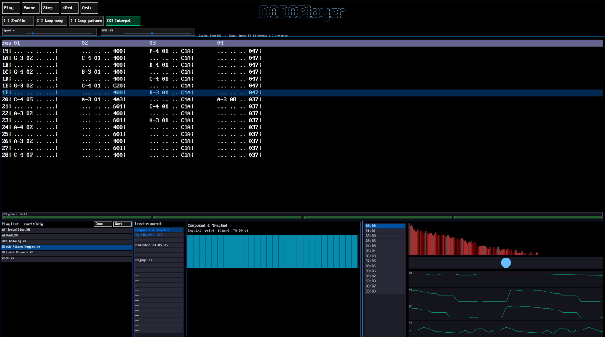

# XM Player

Browser XM (Fast Tracker II) module player: **TypeScript** engine + **canvas** UI (retro VGA-style). Bundled with **Parcel**.
**Budget: ~150 hours of work.**

I built this player in 2018 to learn the basics of procedural music. Since I didn’t have much experience with TypeScript at the time, the code is a bit messy and leans more toward a procedural approach than an object-oriented one. That said, the app is fully functional, with only minor issues, and the editor is written in vanilla TypeScript (no graphics libraries used).

## Run / build

1. `npm install`
2. Put `.xm` files under `assets/mods/` (optional; used for the default playlist).
3. `npm start` — `scripts/generate_files.js` builds `assets/files.json` from that folder, then Parcel serves the app (e.g. `http://localhost:1234`).
4. `npm run build` — output in `dist/`.

Drag-and-drop a `.xm` onto the page or use **Open** anytime; no server beyond static hosting required for the built bundle.

## Architecture (short)

| Area | Role |
|------|------|
| [`src/ui/app.ts`](src/ui/app.ts) | Canvas loop, input, wires panels |
| [`src/ui/layout.ts`](src/ui/layout.ts), [`widgets.ts`](src/ui/widgets.ts), [`input.ts`](src/ui/input.ts) | Virtual 1920×1080 layout, controls, pointer mapping |
| [`src/ui/panels/`](src/ui/panels/) | Toolbar, pattern, playlist, visualizer, instrument |
| [`src/xmlib/player.ts`](src/xmlib/player.ts) | Web Audio graph, `ScriptProcessorNode` → `Tracker` / `Mixer` |
| [`src/xmlib/engine/`](src/xmlib/engine/) | `parser` → `XMFile`, `tracker` + `processor` + `effects`, `mixer` |

More detail, threading notes, and a **file change guide**: [`docs/PRD.MD`](docs/PRD.MD).

## Using the player

- **Transport**: Play / Pause / Stop, previous/next **order** (song position). **Speed** / **BPM** sliders on the toolbar.
- **Playlist**: Click a row to load; **Sort** cycles order (original / A–Z / Z-A); **Shuffle** affects how the next track is chosen after a song ends; **Loop song** / **Loop pattern** / **Interpol** are toggles.
- **Pattern**: Horizontal scroll (wheel) for many channels; **click a row** to seek to that row; **click channel header** to mute, **Alt+click** to solo; bottom strip = **per-channel gain** (click/drag).
- **Order / spectrum / scopes**: Click an **order** line to jump; spectrum is post-master FFT; small scopes and stereo dots are per-channel taps from the engine.
- **Instrument**: Left list selects an instrument; right side shows waveform, envelopes (when present), finetune / relative note.
- **Keyboard**: Space play/pause, F5 stop, F6 play, Left/Right order, Up/Down BPM, `[` / `]` speed, `1`–`0` toggle mutes on channels 1–10 (`0` = ch 10).

## XM format reference

Official-style docs: [FastTracker 2 XM (.xm)](http://ftp.modland.com/pub/documents/format_documentation/FastTracker%202%20v2.04%20(.xm).html)

## License

MIT — see [LICENSE](LICENSE).
